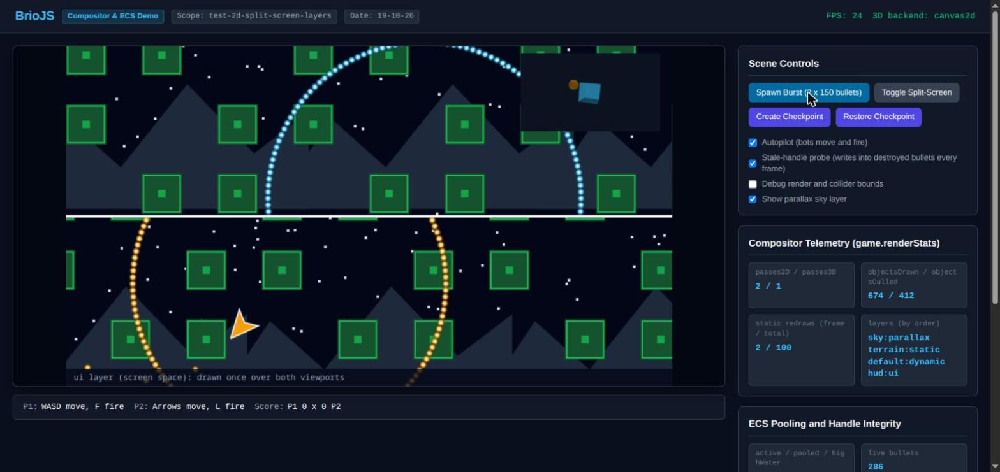

# BrioJS Split-Screen, Layer Compositor & ECS Handle Integrity Demo

Scope: `test-2d-split-screen-layers`  
Date: `19-10-26`



## Overview

This visual demo exercises the `BrioGame` frame compositor and the ECS handle safety introduced in the `refactor` branch. Every texture is generated procedurally at runtime, so the demo ships no binary assets.

1. **Layer Compositor (`BrioLayer`, ADR-0003)**, four layers drawn by ascending `order`:
   - `sky` (`"parallax"`, `scrollFactor { x: 0.15, y: 0.1 }`): 140 stars and a mountain range scrolling slower than the camera.
   - `terrain` (`"static"`): 108 tiles rasterized into one offscreen cache per camera. The cache is only re-rasterized when a tile, the layer, the camera, or `game.scale` changes (`game.renderStats.staticRedraws`).
   - `default` (`"dynamic"`): ships and bullets, redrawn every frame with 2D frustum culling (`objectsCulled`).
   - `hud` (`"ui"`): a screen-space bar and the split divider, drawn **once** over both viewports.

2. **Multi-Viewport Split-Screen (`BrioCamera2D` + `BrioViewport`)**:
   - `cam_p1` uses `split-horizontal-top` and `cam_p2` uses `split-horizontal-bottom`. Each follows its ship with `follow(target, 0.12, deadzone)` and is confined with `setBounds`.
   - **Toggle Split-Screen** removes `cam_p2` at runtime (`game.removeCamera`) and switches `cam_p1` to `fullscreen`.

3. **Hybrid 3D Picture-in-Picture (`BrioCamera3D` + `Canvas2DBackend`)**:
   - The game uses the `"hybrid"` preset, so `BrioRenderer.createBackend()` selects the 3D backend. The selector only returns implemented backends, which today means `canvas2d`.
   - A rotating core (`BrioObject3D`) with a child orb (`addChild`) renders through `cam_radar` in the `minimap-top-right` viewport, with a `clearColor` and an aspect ratio synchronized to the viewport pixels.

4. **ECS Pooling & Stale-Handle Integrity (generations + `unbindECS`)**:
   - Bullets are spawned with `game.instantiate()` and recycled with `game.destroy()`. **Spawn Burst** creates 300 bullets at once, and the telemetry shows `activeCount`, `pooledCount`, and `highWaterMark`.
   - **Stale-handle probe**: the demo keeps references to the last 64 destroyed bullets and writes `+5000` into their transforms on every frame. A shadow simulation integrates every live bullet independently, and any mismatch counts as an **integrity violation**. With the fix the counter stays at `0`. Before the fix, those writes landed in the recycled ECS slots and teleported live bullets.

5. **Checkpoints**:
   - **Create Checkpoint** / **Restore Checkpoint** capture and restore the binary ECS state together with the set of registered objects. Bullets spawned after the checkpoint are unregistered and detached, and bullets destroyed after it come back with their original slot values.

## Controls

| Player | Move | Fire |
| --- | --- | --- |
| P1 (cyan, top viewport) | `W` `A` `S` `D` | `F` |
| P2 (amber, bottom viewport) | Arrow keys | `L` |

`Autopilot` (on by default) moves and fires both ships automatically.

## Automation Hook

`window.__brioSplitDemo` exposes `{ game, readIntegrity(), burst() }` for browser-driven checks (e.g. Claude in Chrome / ChromeDevTools MCP).

## How to Run

1. Build the library distribution:
   ```bash
   npm run build:lin
   ```

2. Serve the repository root via any HTTP server (e.g. `npx serve .` or `python3 -m http.server 8080`).

3. Navigate to:
   ```
   http://localhost:8080/demo/test-2d-split-screen-layers--19-10-26/index.html
   ```

> Note: browsers throttle `requestAnimationFrame` (often to about 1 Hz) in background or occluded windows. `BrioGame.maxDeltaTime` (default `0.1` s) clamps the simulation step, so motion slows down instead of jumping.
