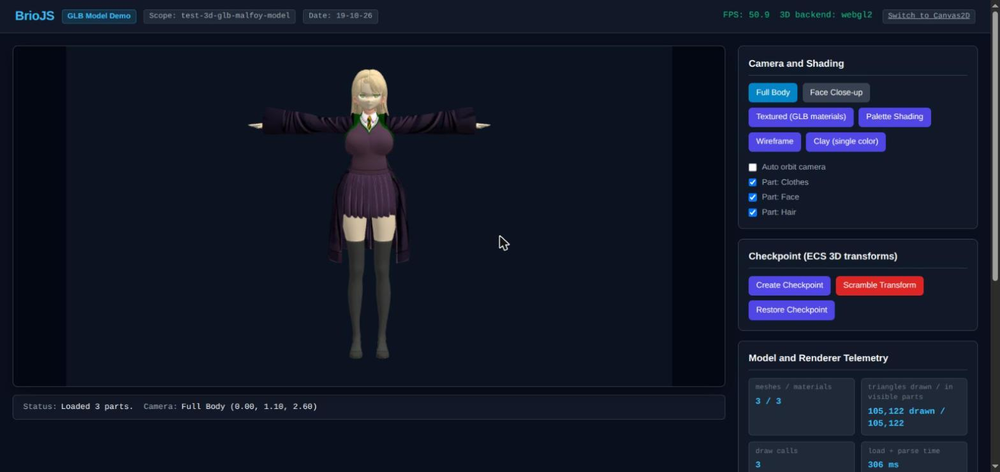

# BrioJS GLB Model Through the BrioGame 3D Pipeline

Scope: `test-3d-glb-malfoy-model`  
Date: `19-10-26`



## Overview

This demo loads a real Sketchfab export (`harry_potter_-_malfoy_draconia_3d_model__dl.glb`, 6 MB, 105,122 triangles, CC-BY-4.0 by HiGuys920) through the full `BrioGame` lifecycle, instead of driving `Canvas2DBackend` by hand:

1. **Preload and instantiation**: `game.preload(() => [new BrioModel(...)])` fetches and parses the GLB, which registers its 3 meshes (`Clothes_Clothes_0`, `Face_Face_0`, `Hair_Hair_0`) and 3 materials. `assets.instantiateModel()` builds a root `BrioObject3D` with one child per part.
2. **3D pass through `BrioCompositor`**: the `"3d"` preset creates the backend with `BrioRenderer.createBackend()`. With WebGL2 available this is `WebGL2Backend`; `?backend=canvas2d` forces the software rasterizer for comparison (link in the header).
3. **`WebGL2Backend` checks** (techniques studied from three.js `WebGLRenderer`):
    - **GPU-resident geometry**: each mesh is uploaded once (one VAO per mesh), so a frame is 3 draw calls and about 0.3 ms of CPU time for 105k triangles, at the 60 fps vsync limit.
    - **Textures**: the 3 embedded PNGs are decoded with `createImageBitmap` and sampled as `SRGB8_ALPHA8` with mipmaps; lighting runs in linear space and output is sRGB-encoded.
    - **Double-sided materials**: the asset marks every material `doubleSided`, so the inside of the coat and skirt is rendered instead of culled.
    - **Smooth shading**: per-pixel normals with hemisphere ambient plus one directional light.
4. **Shading modes**: Textured (GLB materials, default), Palette, Wireframe, Clay. On Canvas2D, Textured falls back to the palette.
5. **Part visibility**: the checkboxes toggle `transform.visibility` per child part.
6. **Checkpoints**: **Scramble Transform** rotates, squashes and moves the root. **Restore Checkpoint** brings back the ECS 3D transform exactly.

## Current limitations (visible in this demo)

- **Skinning**: the skeleton is ignored and the model renders in its bind pose (T-pose), like three.js without an animation clip.
- **Lighting**: there is no image-based lighting, so shading is more contrasted than a three.js scene with an environment map.
- **Canvas2D fallback**: no texture sampling; with double-sided materials nothing is back-face culled, so a frame takes about 230 ms.

## Automation Hook

`window.__brioGlbDemo` exposes `{ game, camera, root, applyShading(mode), setView(key), setOrbit(degrees), readTelemetry() }` for browser-driven checks. `readTelemetry()` includes `backend`, `drawCalls`, `trianglesDrawn`, and `texturedMaterials`.

## How to Run

1. Place the asset at `assets/3d/glb/harry_potter_-_malfoy_draconia_3d_model__dl.glb`. `/assets/` is gitignored.
2. Build the library distribution:
    ```bash
    npm run build:lin
    ```
3. Serve the repository root via any HTTP server (e.g. `python3 -m http.server 8080`).
4. Navigate to:
    ```
    http://localhost:8080/demo/test-3d-glb-malfoy-model--19-10-26/index.html
    ```
