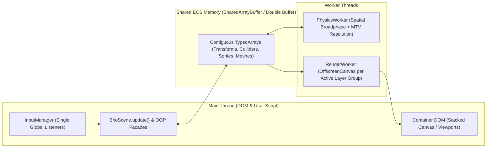

# Arquitetura Alvo da BrioJS (Especificacao Tecnica v1.0)

Este documento especifica a arquitetura alvo da BrioJS na branch `refactor`, consolidando todas as decisoes de design e modelagem de dominio.

---

## 1. Principios Arquiteturais Norteadores

1. **Ponte Pedagógica com Poder Industrial**: Superficie publica simples e intuitiva (OOP + Tooling Functions modulares) apoiada por um nucleo interno orientado a dados (ECS SoA em `TypedArrays`, Multi-Threading e GPU Batching).
2. **Zero-Dependency**: Nenhuma dependencia externa de runtime em `package.json`. Todo o pipeline 2D, 3D, matematico, fisico, de audio e de serializacao e nativo da engine.
3. **Linguagem Ubiqua Estrita**: Aliases sao permitidos **exclusivamente** para abstracoes de complexidade (ex.: presets `"2d"` e `"3d"` na inicializacao), sendo **proibidos** aliases puramente semanticos (ex.: existe apenas `trigger`, nunca `intangible`; existe apenas `BrioAtlas`, nunca `BrioSpriteAtlas`; existem classes concretas `BrioObject2D` e `BrioObject3D`).
4. **Agent Context Optimization (ACO) & Documentacao Total**: 100% das classes, metodos, funcoes, interfaces, tipos e propriedades devem possuir JSDoc/TSDoc rigoroso com descricao clara, `@param`, `@returns` e `@example`, facilitando tanto o aprendizado humano quanto a geracao assertiva de codigo por LLMs.
5. **Tree-Shaking & Modularidade Estrita**: Funcoes utilitarias e subsistemas 2D/3D sao exportados de forma independente sem efeitos colaterais em top-level (`"sideEffects": false`).
6. **Portabilidade Multiplataforma**: Execucao consistente em Navegadores Web, Desktop (Electron), Mobile (Capacitor) e ambientes de teste Headless via deteccao de capacidades (*Feature Detection*) e fallbacks progressivos.

---

## 2. Topologia de Diretorios Proposta (`./src/`)

```text
src/
├── index.ts                      # Entrypoint principal (exports nomeados tree-shakeable)
├── core/
│   ├── BrioGame.ts               # Orquestrador central, presets "2d"|"3d" e BrioGameConfig
│   ├── BrioScene.ts              # Ciclo de vida (preload -> load -> update), cameras e layers
│   ├── BrioLayer.ts              # Camadas de composicao (static, parallax, dynamic, ui)
│   ├── BrioViewport.ts           # Regioes normalizadas de tela (full-screen, split-screen, PiP)
│   └── BrioTimer.ts              # Agendadores (wait, loop, tween) governados pelo deltaTime da cena
├── ecs/
│   ├── ECSWorld.ts               # Registro de EntityIds, bitmasks, archetypes/pools e Object Pool O(1)
│   ├── ComponentStorage.ts       # Armazenamento SoA em TypedArrays (SharedArrayBuffer / ArrayBuffer)
│   └── systems/                  # Sistemas internos (TransformSystem, PhysicsSystem, RenderSystem)
├── objects/
│   ├── BrioObject2D.ts           # Classe concreta 2D (Facade OOP sobre EntityId no ECS)
│   ├── BrioObject3D.ts           # Classe concreta 3D (Facade OOP sobre EntityId no ECS)
│   ├── BrioTransform2D.ts        # Transformacao 2D reativa com suporte a hierarquia Local/World
│   └── BrioTransform3D.ts        # Transformacao 3D reativa (Vec3, Quat/Euler, Mat4, Local/World)
├── rendering/
│   ├── BrioRenderer.ts           # Seletor e fachada do pipeline grafico
│   ├── contracts/
│   │   └── RenderBackend.ts      # Contrato deterministico comum a todas as APIs graficas
│   ├── backends/
│   │   ├── WebGPURenderer.ts     # Prioridade 1: WebGPU (2D Batching & 3D Pipeline)
│   │   ├── WebGL2Renderer.ts     # Prioridade 2: WebGL2 (Instanced Arrays & UBOs)
│   │   ├── WebGL1Renderer.ts     # Prioridade 3: WebGL1 (Fallback GPU universal)
│   │   └── Canvas2DRenderer.ts   # Prioridade 4: Canvas2D + Software 3D Projector fallback
│   └── workers/
│       ├── RenderWorker.ts       # Renderizacao em OffscreenCanvas fora da Main Thread
│       └── LayerCompositor.ts    # Gerenciamento de multiplos canvas / framebuffers
├── assets/
│   ├── BrioAssetManager.ts       # Gerenciador central e loaders assincronos
│   ├── BrioTexture.ts            # Recurso bruto decodificado (ImageBitmap/GPUTexture) + TextureRegistry
│   ├── BrioAtlas.ts              # Mapeamento de sub-regioes arbitrarias e factory de BrioSprite
│   ├── BrioSpriteSheet.ts        # Factory de BrioSprite e BrioAnimation baseada em grade uniforme
│   ├── BrioSprite.ts             # Unidade visual 2D publica
│   ├── BrioAnimation.ts          # Sequencias temporais de quadros (keyframes)
│   ├── BrioTileMap.ts            # Mapas 2D em grade (matrizes / Tiled / LDtk) com merge de colliders
│   ├── BrioMesh.ts               # Geometrias 3D (Box, Sphere, Plane, custom vertices/OBJ/glTF)
│   ├── BrioMaterial.ts           # Definicao de superficie 3D (cor, textura, shading)
│   └── BrioAudio.ts              # Motor hibrido Web Audio API (GainNodes, AudioBuffer) + fallback HTMLAudio
├── cameras/
│   ├── BrioCamera2D.ts           # Camera ortografica 2D (follow, lerp, deadzone, bounds, shake, culling)
│   └── BrioCamera3D.ts           # Camera 3D (perspective/orthographic, fov, near/far, lookAt, frustum)
├── physics/
│   ├── BrioCollision.ts          # Deteccao 2D (AABB, Circle) e 3D (Box3D, Sphere3D) + resolucao MTV
│   ├── BrioRigidBody.ts          # Perfil fisico opcional (velocidade, gravidade, atrito, restituicao)
│   ├── SpatialHash2D.ts          # Broadphase 2D para evitar complexidade O(N^2)
│   ├── SpatialOctree3D.ts        # Broadphase 3D
│   └── PhysicsWorker.ts          # Simulacao fisica desacoplada em Web Worker
├── input/
│   ├── InputManager.ts           # Listener unico global por dispositivo na Main Thread
│   ├── BrioKeyboard.ts           # Estado de teclado por instancia + metodos estaticos globais
│   ├── BrioMouse.ts              # Posicao (Screen/World), botoes, wheel e picking
│   ├── BrioTouch.ts              # Suporte multi-touch para Web Mobile e Capacitor
│   └── BrioGamepad.ts            # Polling da Gamepad API com zonas mortas (deadzones) e vibracao
├── storage/
│   ├── BrioSerializer.ts         # Snapshots binarios puros (ArrayBuffer) do ECS + tradutor opcional JSON
│   └── BrioStorage.ts            # Persistencia multiplataforma (state, session, local, db/IndexedDB)
├── math/
│   ├── BrioMath.ts               # Funcoes matematicas escalares (clamp, lerp, degToRad, radToDeg)
│   ├── vec2.ts                   # Funcoes puras tree-shakeable + classe atomica reativa BrioVec2
│   ├── vec3.ts                   # Funcoes puras tree-shakeable + classe atomica reativa BrioVec3
│   ├── quat.ts                   # Quaternions para rotacao 3D sem Gimbal Lock
│   └── mat4.ts                   # Matrizes 4x4 para transformacao e projecao 3D
├── debugging/
│   ├── BrioDebugger.ts           # Configuracao zero-allocation de debug visual e console
│   ├── BrioConsole.ts            # Logger com filtro de stack trace (usuario vs interno)
│   └── game_logs.ts              # Catalogo tipado de erros e excecoes
└── tools/
    ├── base_types.ts             # Template Literal Types (CSS, Keys, Anchors, Colors)
    └── PlatformAdapter.ts        # Abstracao de ambiente (Browser, Electron, Capacitor, Headless)
```

---

## 3. Especificacao Detalhada dos Subsistemas

### 3.1. Entrypoint `BrioGame` e Presets `"2d"` / `"3d"`
`BrioGame` permanece como a classe central de entrada da engine, aceitando tanto uma configuracao simplificada via preset (`"2d"` ou `"3d"`) quanto um objeto completo `BrioGameConfig`:

```ts
export type GameDimensionPreset = "2d" | "3d";

export interface BrioGameConfig {
    dimension: GameDimensionPreset;
    width: number;
    height: number;
    container: HTMLElement;
    preferredBackend?: "webgpu" | "webgl2" | "webgl1" | "canvas2d" | "auto";
    useOffscreenWorkers?: boolean;
    maxEntities?: number;
    pixelArt?: boolean;
}
```

- Quando o usuario inicializa `new BrioGame(640, 480, container, "2d")` (ou omite o preset, assumindo `"2d"` por padrao), a engine aplica automaticamente as configuracoes ideais para 2D.
- Quando inicializa com `"3d"` ou um `BrioGameConfig` detalhado, o pipeline correspondente e alocado sob demanda.
- `BrioGame` instancia uma `defaultScene: BrioScene` implicita para que iniciantes possam encadear `game.preload(...).load(...).update(...)` diretamente, enquanto usuarios intermediarios/avancados podem registrar multiplas cenas via `game.addScene(scene)` e alternar com `game.setScene("level_1")`.

### 3.2. Pipeline Grafico Multi-Backend (`WebGPU -> WebGL2 -> WebGL1 -> Canvas2D`)
Todos os backends implementam a interface estrita `RenderBackend`:
- **`init(surface: HTMLCanvasElement | OffscreenCanvas): Promise<boolean>`**
- **`beginFrame(viewport: ViewportRect, clearColor?: Color): void`**
- **`flushLayer2D(layerData: LayerRenderBuffer2D, cameraMatrix: Float32Array): void`**
- **`flushLayer3D(layerData: LayerRenderBuffer3D, viewProjMatrix: Float32Array): void`**
- **`endFrame(): void`**
- **`dispose(): void`**

Cadeia de selecao automatica (`preferredBackend: "auto"`):
1. **WebGPU (`WebGPURenderer`)**: Utiliza `GPURenderPipeline` e storage/uniform buffers alimentados diretamente pelos `Float32Array` do ECS.
2. **WebGL2 (`WebGL2Renderer`)**: Utiliza `drawArraysInstanced` / `drawElementsInstanced` e Vertex Array Objects (VAOs) para desenhar milhares de sprites 2D ou malhas 3D em poucas draw calls.
3. **WebGL1 (`WebGL1Renderer`)**: Utiliza batching dinamico de vertices em `ARRAY_BUFFER` para compatibilidade com GPUs antigas.
4. **Canvas2D (`Canvas2DRenderer`)**: Fallback universal. No modo 2D, utiliza `CanvasRenderingContext2D` (`OffscreenCanvasRenderingContext2D` quando em Worker). No modo 3D, ativa um **Software 3D Projector** integrado que projeta os vertices das malhas 3D pela matriz `ViewProjection` e desenha os poligonos ordenados por profundidade (*Painter's Algorithm*).

### 3.3. Compositor Multi-Canvas (`BrioLayer`), Multi-Viewport (Split-Screen) e `OffscreenCanvas` Workers
Para atender desde jogos 2D com multiplas camadas de Parallax e UI complexa (ex.: caixas de dialogo sobrepostas ao jogo e HUD acima das caixas de dialogo, estilo *Persona*) ate jogos com tela dividida para multiplayer local (estilo *Gears of War 3*):



1. **Politicas de Camada (`BrioLayer`)**:
   - `static`: Possui seu proprio buffer/canvas dedicado. Renderiza apenas uma vez no `load` ou quando uma entidade dessa camada sofre mutacao (*dirty flag*). Custo zero por frame.
   - `parallax`: Possui fator de rolagem `scrollFactor: Vec2` relativo a camera ativa.
   - `dynamic`: Redesenha a cada frame acompanhando as transformacoes do ECS.
   - `ui`: Opera em coordenadas de tela (*Screen Space*) e aceita empilhamento arbitrario (`order: number`), permitindo criar subcamadas independentes (ex.: `ui-world-indicators` -> `ui-dialogue-box` -> `ui-dialogue-portrait` -> `ui-top-hud` -> `ui-modal-pause`).
2. **Multiplos Viewports (`BrioViewport`)**:
   - Uma `BrioScene` suporta multiplas cameras ativas simultaneamente (`scene.cameras`).
   - Cada camera possui um `viewport: { x: number, y: number, width: number, height: number }` normalizado entre `0` e `1` (padrao `{ x: 0, y: 0, width: 1, height: 1 }`).
   - Para Split-Screen de 2 jogadores (horizontal ou vertical) ou 4 jogadores, basta instanciar 2 ou 4 cameras apontando para alvos distintos com seus respectivos retangulos de viewport; o `BrioRenderer` aplica `scissor` / `viewport` clipping para cada camera no mesmo frame.
3. **Sincronizacao de Threads (`SharedArrayBuffer` -> `Transferable` -> `MainThread`)**:
   - A Main Thread processa exclusivamente eventos do DOM (Input) e a logica de alto nivel do usuario.
   - O `RenderWorker` assume o controle dos elementos `<canvas>` via `transferControlToOffscreen()`.
   - O `PhysicsWorker` executa a Broadphase e resolucao de colisoes sobre os `TypedArrays` do ECS.

### 3.4. Ponte API Publica OOP vs. Core Interno ECS (SoA)
- Cada `BrioObject2D` ou `BrioObject3D` instanciado pelo usuario recebe um `entityId: number` alocado pelo `ECSWorld`.
- Os dados de transformacao, velocidade, colisao e renderizacao residem em arrays tipados pre-alocados (`Float32Array`, `Uint32Array`, `Uint8Array`) dentro de `ComponentStorage`.
- As propriedades vetoriais expostas na API publica (`transform.position`, `transform.scale`, `transform.size`, `transform.pivot`, `transform.skew`) sao instancias de `BrioVec2` / `BrioVec3` vinculadas ao indice da entidade no `Float32Array`.
- Quando o usuario escreve `player.transform.scale.x = -2`, o setter `x` de `BrioVec2` escreve diretamente no `Float32Array` do ECS, atualiza a flag de flip e marca o bit `DIRTY_TRANSFORM` da entidade, sem alocar nenhum objeto na memoria.
- **Object Pooling Transparente**: `scene.instantiate(prefab)` reutiliza IDs de entidades previamente destruidas via `scene.destroy(entity)` em tempo $O(1)$ usando uma *free-list* interna, copiando apenas a linha de bytes do prefab nos arrays de componentes.

### 3.5. Fisica, Colisoes (`solid` vs. `trigger`) e Broadphase
- **Linguagem Ubiqua**: O modo de colisao e estritamente `"solid"` ou `"trigger"`.
- **Resolucao Fisica (`"solid"`)**: Calcula o *Minimum Translation Vector* (MTV) simetrico para `rectangle`, `square`, `circle` (2D) e `box`, `sphere` (3D), separando automaticamente objetos solidos e ajustando a velocidade caso possuam `BrioRigidBody`.
- **Deteccao de Eventos (`"trigger"`)**: Nao aplica forca de separacao; registra callbacks `onTriggerEnter`, `onTriggerStay`, `onTriggerExit` ou retorna `true` na consulta direta `BrioCollision.isOverlapping(a, b)`.
- **Broadphase**: Um `SpatialHash2D` (em 2D) e uma `SpatialOctree3D` (em 3D) particionam o espaco automaticamente a cada step fisico, reduzindo os testes de colisao para pares na mesma celula espacial.

### 3.6. Serializacao Binaria Pura (`BrioSerializer`) e `BrioStorage`
- Como todo o estado mutavel da cena reside nos `TypedArrays` do `ECSWorld`, `BrioSerializer.captureSnapshot(scene)` gera um `Uint8Array` / `ArrayBuffer` compacto com cabecalho binario (magic bytes, versao, contagem de entidades ativas, tabela de offsets de componentes) e copia direta de memoria (`TypedArray.set`).
- `scene.createCheckpoint()` e `scene.restart()` restauram o `ArrayBuffer` diretamente nos pools do ECS em menos de 1 milissegundo, sem envolver `JSON.stringify` ou `JSON.parse`.
- Uma camada opcional de traducao (`BrioSerializer.toJSON(snapshot)` e `BrioSerializer.fromJSON(json)`) converte o buffer binario para JSON legivel apenas quando o desenvolvedor desejar exportar/inspecionar arquivos externos.
